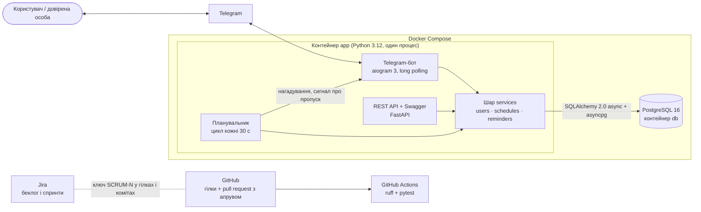

# Обґрунтування системної архітектури та інструментарію (SCRUM-67)

Прототип «Ліки вчасно» побудовано як один застосунок (контейнер `app`), у якому працюють Telegram-бот, REST API і планувальник нагадувань, та окрему базу даних PostgreSQL (контейнер `db`). Обидва контейнери запускаються однією командою `docker compose up`. Веб-кабінет (React) і розгортання на хостингу перенесено на етап 5.

## 1. Схема компонентів

Обробники бота і ендпоінти API не містять бізнес-логіки: вони лише викликають функції шару `services` і повертають відповідь. Функції правила нагадувань (`take`, `snooze`, `tick`) отримують поточний час параметром, тому їх легко перевіряти модульними тестами з будь-яким моментом часу. Міграції Alembic виконуються автоматично під час старту контейнера `app`.

## 2. Інструменти

| Інструмент | Для чого | Чому обрали | Яку альтернативу відкинули |
| --- | --- | --- | --- |
| Python 3.12 | Мова всього бекенду, бота і тестів | Одна мова для бота, API і тестів, команда її знає. | Node.js – довелося б розділити стек між двома мовами. |
| FastAPI | REST API і автоматична документація Swagger | Асинхронний, сам генерує Swagger з типів. | Flask – немає вбудованої валідації даних і Swagger, підтримка async обмежена. |
| aiogram 3 | Telegram-бот: команди, кнопки, обробка натискань | Асинхронний, працює в одному циклі подій з FastAPI. | python-telegram-bot – теж асинхронний, але в aiogram зручніші роутери й фільтри для кнопок. |
| SQLAlchemy 2.0 + Alembic | Моделі БД, async-запити, версіоновані міграції | Типізовані моделі й міграції, що запускаються автоматично. | «Сирий» SQL – немає контролю версій схеми. |
| PostgreSQL 16 | Зберігання користувачів, розкладів, прийомів, журналу | Надійна реляційна БД із підтримкою часових поясів. | SQLite – не розрахована на одночасну роботу бота, API і планувальника (лишили її лише для модульних тестів). |
| Docker Compose | Запуск app і db однією командою | Однакове оточення в усіх шістьох учасників. | Ручне встановлення PostgreSQL на кожен ноутбук. |
| pytest | Модульні (SQLite у пам'яті) та інтеграційні (PostgreSQL) тести | Простий синтаксис, фікстури для чистої БД у кожному тесті. | unittest – більше шаблонного коду. |
| GitHub Actions | CI: ruff і pytest на кожен pull request | Вбудований у GitHub, безкоштовний для навчального репозиторію. | Jenkins – потребує власного сервера. |
| Jira | Беклог, спринти, статуси задач | Вимога курсу, підтримує Scrum і зв'язок із GitHub через ключі задач. | Trello – немає спринтів і оцінок у story points. |

## 3. Чому бот, API і планувальник в одному процесі

Для прототипу один процес – найпростіше робоче рішення. Бот, API і планувальник спільно користуються підключенням до бази даних і одним об'єктом бота, тому планувальник надсилає нагадування напряму, без черги повідомлень, а кнопки бота викликають ту саму логіку, що й API, без HTTP-запитів. Розгортання зводиться до двох контейнерів. Мінус – таке рішення не масштабується горизонтально: два екземпляри `app` надсилали б однакові нагадування. На фазі 2 (пілот) планувальник можна винести в окремий сервіс.

## 4. Чому планувальник – простий цикл, а не Celery чи cron

Усе правило нагадувань зводиться до однієї таблиці `intakes` і кількох моментів часу: T – нагадування, T+30 – повтор, T+60 – «пропущено» і сигнал довіреній особі. Асинхронний цикл кожні 30 секунд перевіряє цю таблицю й вирішує, що надіслати. Celery потребував би брокера повідомлень (Redis або RabbitMQ) і окремого воркера, а cron – окремого процесу, який на кожен запуск заново підключається до бази даних і бота. Правило покрите модульними тестами з підставленим часом, тому простий цикл достатньо надійний для прототипу. Похибка до 30 секунд для нагадування про ліки некритична.
